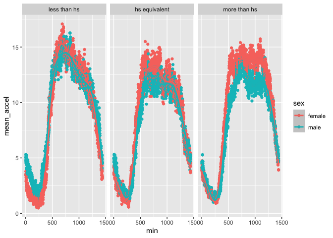
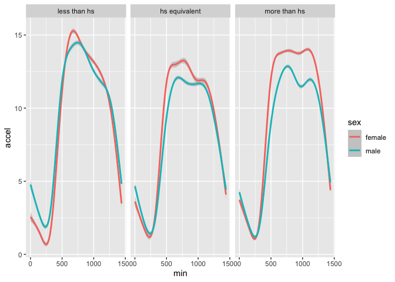

P8105 HW3 - jsm2298
================
2026-10-15

# Load Packages

``` r
library(p8105.datasets)
library(tidyverse)
```

    ## ── Attaching core tidyverse packages ──────────────────────── tidyverse 2.0.0 ──
    ## ✔ dplyr     1.2.1     ✔ readr     2.2.0
    ## ✔ forcats   1.0.1     ✔ stringr   1.6.0
    ## ✔ ggplot2   4.0.3     ✔ tibble    3.3.1
    ## ✔ lubridate 1.9.5     ✔ tidyr     1.3.2
    ## ✔ purrr     1.2.2     
    ## ── Conflicts ────────────────────────────────────────── tidyverse_conflicts() ──
    ## ✖ dplyr::filter() masks stats::filter()
    ## ✖ dplyr::lag()    masks stats::lag()
    ## ℹ Use the conflicted package (<http://conflicted.r-lib.org/>) to force all conflicts to become errors

## Problem 1

### Load Data:

``` r
data("ny_noaa")
```

### The goal is to do some exploration of this dataset. To that end, write a short description of the dataset, noting the size and structure of the data, describing some key variables, and indicating the extent to which missing data is an issue. Then, do or answer the following (commenting on the results of each):

### Do some data cleaning. Create separate variables for year, month, and day. Ensure observations for temperature, precipitation, and snowfall are given in reasonable units. For snowfall, what are the most commonly observed values? Why?

### Make a two-panel plot showing the average max temperature in January and in July in each station across years. Is there any observable / interpretable structure? Any outliers?

### Make a two-panel plot showing (i) tmax vs tmin for the full dataset (note that a scatterplot may not be the best option); and (ii) make a plot showing the distribution of snowfall values greater than 0 and less than 100 separately by year.

## Problem 2

### Accelerometers have become an appealing alternative to self-report techniques for studying physical activity in observational studies and clinical trials, largely because of their relative objectivity. During observation periods, the devices can measure MIMS in a short period; one-minute intervals are common. Because accelerometers can be worn comfortably and unobtrusively, they produce around-the-clock observations.

### This problem uses accelerometer data collected on 250 participants in the NHANES study. The participants’ demographic data can be downloaded here, and their accelerometer data can be downloaded here. Variables \*MIMS are the MIMS values for each minute of a 24-hour day starting at midnight.

### Load, tidy, merge, and otherwise organize the data sets. Your final dataset should include all originally observed variables; exclude participants less than 21 years of age, and those with missing demographic data; and encode data with reasonable variable classes (i.e. not numeric, and using factors with the ordering of tables and plots in mind).

#### Load Data

``` r
nhanes_accel_df <- read_csv("data/nhanes_accel.csv")
```

    ## Rows: 250 Columns: 1441
    ## ── Column specification ────────────────────────────────────────────────────────
    ## Delimiter: ","
    ## dbl (1441): SEQN, min1, min2, min3, min4, min5, min6, min7, min8, min9, min1...
    ## 
    ## ℹ Use `spec()` to retrieve the full column specification for this data.
    ## ℹ Specify the column types or set `show_col_types = FALSE` to quiet this message.

``` r
nhanes_covar_df <- read_csv("data/nhanes_covar.csv", skip = 4)
```

    ## Rows: 250 Columns: 5
    ## ── Column specification ────────────────────────────────────────────────────────
    ## Delimiter: ","
    ## dbl (5): SEQN, sex, age, BMI, education
    ## 
    ## ℹ Use `spec()` to retrieve the full column specification for this data.
    ## ℹ Specify the column types or set `show_col_types = FALSE` to quiet this message.

#### Tidy the acceleration data:

``` r
nhanes_accel_df = nhanes_accel_df |> 
  janitor::clean_names() |> 
  pivot_longer(contains("min"),
               names_to = "min",
               values_to = "accel",
               names_prefix = "min") |> 
  mutate(min = as.numeric(min))
```

#### Tidy covariates:

``` r
nhanes_covar_df = nhanes_covar_df |> 
  janitor::clean_names() |> ## Clean the names.
  mutate(sex = as.factor( ## Re-code factors and ordering.
    case_when(
      sex == 2 ~ "female",
      sex == 1 ~ "male"
    )
  ),
  education = factor(
    case_when(
      education == 1 ~ "less than hs",
      education == 2 ~ "hs equivalent",
      education == 3 ~ "more than hs"
    ), levels = c("less than hs", "hs equivalent", "more than hs")
  )) |> 
  filter(age >= 21) |> ## Exclude participants less than 21 years old.
  drop_na() ## Remove NA values
```

#### Merge data:

``` r
## Merge in participants keeping only those with full demographic data:
nhanes_df = nhanes_accel_df |> 
  right_join(nhanes_covar_df, by = "seqn") 
```

### Produce a reader-friendly table for the number of men and women in each education category, and create a visualization of the age distributions for men and women in each education category. Comment on these items.

``` r
## Create the table:
nhanes_df |> 
  pivot_wider(names_from = min, values_from = accel) |>
  group_by(education, sex) |> 
  summarize(n = n())
```

    ## `summarise()` has regrouped the output.
    ## ℹ Summaries were computed grouped by education and sex.
    ## ℹ Output is grouped by education.
    ## ℹ Use `summarise(.groups = "drop_last")` to silence this message.
    ## ℹ Use `summarise(.by = c(education, sex))` for per-operation grouping
    ##   (`?dplyr::dplyr_by`) instead.

    ## # A tibble: 6 × 3
    ## # Groups:   education [3]
    ##   education     sex        n
    ##   <fct>         <fct>  <int>
    ## 1 less than hs  female    28
    ## 2 less than hs  male      27
    ## 3 hs equivalent female    23
    ## 4 hs equivalent male      35
    ## 5 more than hs  female    59
    ## 6 more than hs  male      56

``` r
## Create the plot:
nhanes_df |> 
  pivot_wider(names_from = min, values_from = accel) |>
  ggplot(aes(x = age, color = sex, fill = sex)) +
  geom_density(alpha = 0.4) +
  facet_wrap(. ~ education)
```

<!-- -->

The table shows that there are fewer participants in the less than hs
and the hs equivalent education groups relative to the more than hs
education group. Also, the number of female and male participants are
similar within the less than hs and more than hs groups, but there are
much more male participants in the hs equivalent education group.

The plot shows interesting differences in the distribution of age across
different levels of education and sex groups. We see that the
participants with less than high school or high school equivalent
education scores have more participants of higher age (except for males
in the high school equivalent group, who are mostly younger). In
contrast, participants with more than a high school education have a
higher density of younger participants across both sexes.

### Traditional analyses of accelerometer data focus on the total activity over the day. Using your tidied data set, aggregate across minutes to create a total activity variable for each participant. Plot these total activities (y-axis) against age (x-axis); your plot should compare men to women and have separate panels for each education level. Include a trend line or a smooth to illustrate differences. Comment on your plot.

``` r
nhanes_df |> 
  group_by(seqn, age, sex, education) |> 
  summarize(mean_accel = mean(accel)) |> 
  ggplot(aes(x = age, y = mean_accel, color = sex)) +
  geom_point() + 
  geom_smooth(method = "lm", se = F) +
  facet_wrap(. ~ education) +
  labs(x = "Age", y = "Mean Acceleration (Per Subject)",
       title = "Age vs Mean Activity Between Subjects",
       subtitle = "Seperated by Education Level and Sex") 
```

    ## `summarise()` has regrouped the output.
    ## `geom_smooth()` using formula = 'y ~ x'
    ## ℹ Summaries were computed grouped by seqn, age, sex, and education.
    ## ℹ Output is grouped by seqn, age, and sex.
    ## ℹ Use `summarise(.groups = "drop_last")` to silence this message.
    ## ℹ Use `summarise(.by = c(seqn, age, sex, education))` for per-operation
    ##   grouping (`?dplyr::dplyr_by`) instead.

<!-- -->
This plot shows a unique example of moderation based on level of
education. Across the groups, activity (mean acceleration) decreases
with increasing age. However, the relationship seems to become
attenuated as education increases such that those of higher education
have less of an decrease in activity as they age. We see some
sex-related differences, with the largest intercept and rate differences
between men and women seen in the higher education group.

### Accelerometer data allows the inspection activity over the course of the day. Make a three-panel plot that shows the 24-hour activity time courses for each education level and use color to indicate sex. Describe in words any patterns or conclusions you can make based on this graph; including smooth trends may help identify differences.

``` r
## Plot data with points:
nhanes_df |> 
  group_by(min, sex, education) |> 
  summarize(mean_accel = mean(accel)) |> 
  ggplot(aes(x = min, y = mean_accel, color = sex)) +
  geom_point() +
  geom_smooth() +
  facet_wrap(~ education, nrow = 1)
```

    ## `summarise()` has regrouped the output.
    ## `geom_smooth()` using method = 'gam' and formula = 'y ~ s(x, bs = "cs")'
    ## ℹ Summaries were computed grouped by min, sex, and education.
    ## ℹ Output is grouped by min and sex.
    ## ℹ Use `summarise(.groups = "drop_last")` to silence this message.
    ## ℹ Use `summarise(.by = c(min, sex, education))` for per-operation grouping
    ##   (`?dplyr::dplyr_by`) instead.

<!-- -->

``` r
## Plot only smoothed lines:
nhanes_df |> 
  ggplot(aes(x = min, y = accel, color = sex)) +
  geom_smooth() +
  facet_wrap(~ education, nrow = 1)
```

    ## `geom_smooth()` using method = 'gam' and formula = 'y ~ s(x, bs = "cs")'

<!-- -->

The curves show similar relationships across each education group with
slight differences. We see across sex and education, that activity peaks
in the waking hours of the day time and drops into the evening. Those
with less than a high school degree seem to be more active earlier in
the day with steeper decreases as the day progresses, while those with a
high school diploma or above seem to have a more constant activity
pattern during the day and then a sharper decline in the evening. The
major sex differences are found in the group with a high school degree
or above, as male participants seem to show less activity during the
day.

I decided to interpret the question as asking for mean activity across
each minute for each group. Otherwise, the points are far too
overwhelming to gather meaningful data from the plot. I also included a
plot with only the fitted spline equations to the original data to see
where the underlying trends of activity show.
