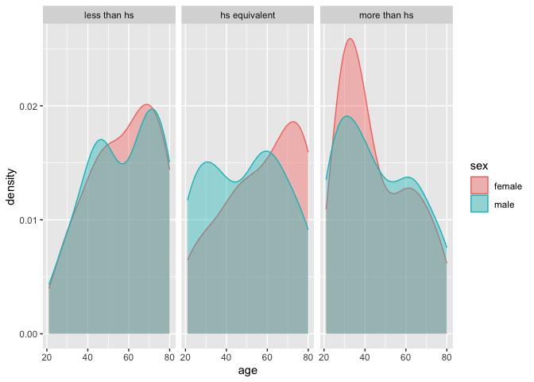
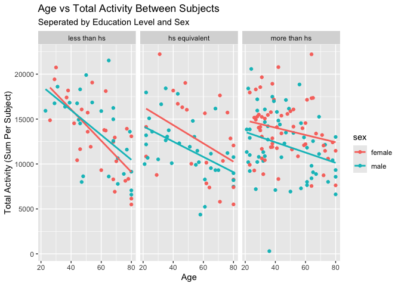
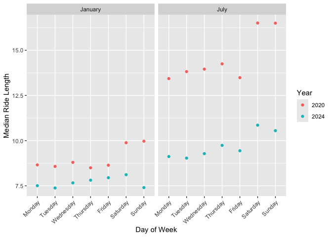
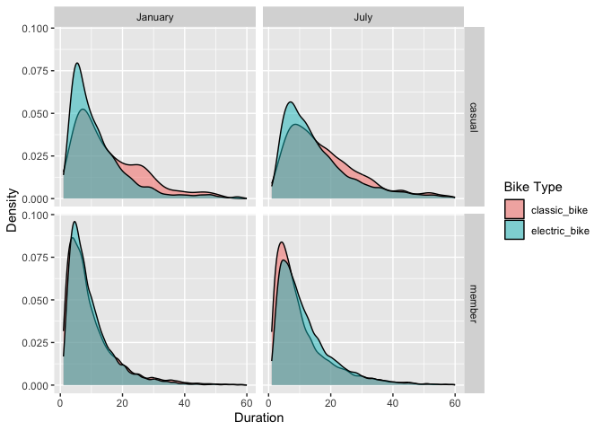

P8105 HW3 - jsm2298
================
2026-10-15

# Load Packages

``` r
library(p8105.datasets)
library(tidyverse)
```

    ## ── Attaching core tidyverse packages ──────────────────────── tidyverse 2.0.0 ──
    ## ✔ dplyr     1.2.1     ✔ readr     2.2.0
    ## ✔ forcats   1.0.1     ✔ stringr   1.6.0
    ## ✔ ggplot2   4.0.3     ✔ tibble    3.3.1
    ## ✔ lubridate 1.9.5     ✔ tidyr     1.3.2
    ## ✔ purrr     1.2.2     
    ## ── Conflicts ────────────────────────────────────────── tidyverse_conflicts() ──
    ## ✖ dplyr::filter() masks stats::filter()
    ## ✖ dplyr::lag()    masks stats::lag()
    ## ℹ Use the conflicted package (<http://conflicted.r-lib.org/>) to force all conflicts to become errors

## Problem 2

### Accelerometers have become an appealing alternative to self-report techniques for studying physical activity in observational studies and clinical trials, largely because of their relative objectivity. During observation periods, the devices can measure MIMS in a short period; one-minute intervals are common. Because accelerometers can be worn comfortably and unobtrusively, they produce around-the-clock observations.

### This problem uses accelerometer data collected on 250 participants in the NHANES study. The participants’ demographic data can be downloaded here, and their accelerometer data can be downloaded here. Variables \*MIMS are the MIMS values for each minute of a 24-hour day starting at midnight.

### Load, tidy, merge, and otherwise organize the data sets. Your final dataset should include all originally observed variables; exclude participants less than 21 years of age, and those with missing demographic data; and encode data with reasonable variable classes (i.e. not numeric, and using factors with the ordering of tables and plots in mind).

#### Load Data

``` r
nhanes_accel_df <- read_csv("data/nhanes_accel.csv")
```

    ## Rows: 250 Columns: 1441
    ## ── Column specification ────────────────────────────────────────────────────────
    ## Delimiter: ","
    ## dbl (1441): SEQN, min1, min2, min3, min4, min5, min6, min7, min8, min9, min1...
    ## 
    ## ℹ Use `spec()` to retrieve the full column specification for this data.
    ## ℹ Specify the column types or set `show_col_types = FALSE` to quiet this message.

``` r
nhanes_covar_df <- read_csv("data/nhanes_covar.csv", skip = 4)
```

    ## Rows: 250 Columns: 5
    ## ── Column specification ────────────────────────────────────────────────────────
    ## Delimiter: ","
    ## dbl (5): SEQN, sex, age, BMI, education
    ## 
    ## ℹ Use `spec()` to retrieve the full column specification for this data.
    ## ℹ Specify the column types or set `show_col_types = FALSE` to quiet this message.

#### Tidy the acceleration data:

``` r
nhanes_accel_df = nhanes_accel_df |> 
  janitor::clean_names() |> 
  pivot_longer(contains("min"),
               names_to = "min",
               values_to = "activity",
               names_prefix = "min") |> 
  mutate(min = as.numeric(min))
```

#### Tidy covariates:

``` r
nhanes_covar_df = nhanes_covar_df |> 
  janitor::clean_names() |> ## Clean the names.
  mutate(sex = as.factor( ## Re-code factors and ordering.
    case_when(
      sex == 2 ~ "female",
      sex == 1 ~ "male"
    )
  ),
  education = factor(
    case_when(
      education == 1 ~ "less than hs",
      education == 2 ~ "hs equivalent",
      education == 3 ~ "more than hs"
    ), levels = c("less than hs", "hs equivalent", "more than hs")
  )) |> 
  filter(age >= 21) |> ## Exclude participants less than 21 years old.
  drop_na() ## Remove NA values
```

#### Merge data:

``` r
## Merge in participants keeping only those with full demographic data:
nhanes_df = nhanes_accel_df |> 
  right_join(nhanes_covar_df, by = "seqn") 
```

### Produce a reader-friendly table for the number of men and women in each education category, and create a visualization of the age distributions for men and women in each education category. Comment on these items.

``` r
## Create the table:
table_1 = nhanes_df |> 
  pivot_wider(names_from = min, values_from = activity) |>
  group_by(education, sex) |> 
  summarize(n = n())
```

    ## `summarise()` has regrouped the output.
    ## ℹ Summaries were computed grouped by education and sex.
    ## ℹ Output is grouped by education.
    ## ℹ Use `summarise(.groups = "drop_last")` to silence this message.
    ## ℹ Use `summarise(.by = c(education, sex))` for per-operation grouping
    ##   (`?dplyr::dplyr_by`) instead.

``` r
colnames(table_1) = c("Education", "Sex", "Number of Participants")

print(table_1)
```

    ## # A tibble: 6 × 3
    ## # Groups:   Education [3]
    ##   Education     Sex    `Number of Participants`
    ##   <fct>         <fct>                     <int>
    ## 1 less than hs  female                       28
    ## 2 less than hs  male                         27
    ## 3 hs equivalent female                       23
    ## 4 hs equivalent male                         35
    ## 5 more than hs  female                       59
    ## 6 more than hs  male                         56

``` r
## Create the plot:
nhanes_df |> 
  pivot_wider(names_from = min, values_from = activity) |>
  ggplot(aes(x = age, color = sex, fill = sex)) +
  geom_density(alpha = 0.4) +
  facet_wrap(. ~ education)
```

<!-- -->

The table shows that there are fewer participants in the less than hs
and the hs equivalent education groups relative to the more than hs
education group. Also, the number of female and male participants are
similar within the less than hs and more than hs groups, but there are
much more male participants in the hs equivalent education group.

The plot shows interesting differences in the distribution of age across
different levels of education and sex groups. We see that the
participants with less than high school or high school equivalent
education scores have more participants of higher age (except for males
in the high school equivalent group, who are mostly younger). In
contrast, participants with more than a high school education have a
higher density of younger participants across both sexes.

### Traditional analyses of accelerometer data focus on the total activity over the day. Using your tidied data set, aggregate across minutes to create a total activity variable for each participant. Plot these total activities (y-axis) against age (x-axis); your plot should compare men to women and have separate panels for each education level. Include a trend line or a smooth to illustrate differences. Comment on your plot.

``` r
nhanes_df |> 
  group_by(seqn, age, sex, education) |> 
  summarize(total_activity = sum(activity)) |> 
  ggplot(aes(x = age, y = total_activity, color = sex)) +
  geom_point() + 
  geom_smooth(method = "lm", se = F) +
  facet_wrap(. ~ education) +
  labs(x = "Age", y = "Total Activity (Sum Per Subject)",
       title = "Age vs Total Activity Between Subjects",
       subtitle = "Seperated by Education Level and Sex") 
```

    ## `summarise()` has regrouped the output.
    ## `geom_smooth()` using formula = 'y ~ x'
    ## ℹ Summaries were computed grouped by seqn, age, sex, and education.
    ## ℹ Output is grouped by seqn, age, and sex.
    ## ℹ Use `summarise(.groups = "drop_last")` to silence this message.
    ## ℹ Use `summarise(.by = c(seqn, age, sex, education))` for per-operation
    ##   grouping (`?dplyr::dplyr_by`) instead.

<!-- -->

This plot shows a unique example of moderation based on level of
education. Across the groups, activity (mean acceleration) decreases
with increasing age. However, the relationship seems to become
attenuated as education increases such that those of higher education
have less of an decrease in activity as they age. We see some
sex-related differences, with the largest intercept and rate differences
between men and women seen in the higher education group.

### Accelerometer data allows the inspection activity over the course of the day. Make a three-panel plot that shows the 24-hour activity time courses for each education level and use color to indicate sex. Describe in words any patterns or conclusions you can make based on this graph; including smooth trends may help identify differences.

``` r
## Plot data with points:
nhanes_df |> 
  filter(
    activity >= quantile(activity, 0.25, na.rm = TRUE) - 1.5 * IQR(activity, na.rm = TRUE) & # Filter data to remove extreme outliers
    activity <= quantile(activity, 0.75, na.rm = TRUE) + 1.5 * IQR(activity, na.rm = TRUE)
  ) |> 
  ggplot(aes(x = min, y = activity, color = sex)) +
  geom_point(alpha = 0.03) +
  geom_smooth() +
  facet_wrap(~ education, nrow = 1)
```

    ## `geom_smooth()` using method = 'gam' and formula = 'y ~ s(x, bs = "cs")'

<!-- -->

I decided to remove outliers from the data to improve the readability of
the plot. When outliers were included, the plot became very hard to
interpret.The curves show similar relationships across each education
group with slight differences. We see across sex and education, that
activity peaks in the waking hours of the day time and drops into the
evening. Those with less than a high school degree seem to be more
active earlier in the day with steeper decreases as the day progresses,
while those with a high school diploma or above seem to have a more
constant activity pattern during the day and then a sharper decline in
the evening. The major sex differences are found in the group with a
high school degree or above, as male participants seem to show less
activity during the day.

## Problem 3

### Citi Bike is a bike sharing system in New York City; riders can rent pedal-powered or electric bikes from starting stations and return them to another station at their destination. Introduced in 2013, the system is immensely popular and expanded rapidly. Riders who use this system often may become “members” with lower rental rates.

### This zip file contains data on rides taken on the NYC Citi Bike system. Files contain 1% of all rides with a total duration less than 4 hours in each of four months. Import, clean, and tidy these data, and describe the resulting dataset.

``` r
## Load all data:
citi_jan_20 <- read_csv("data/citibike/Jan 2020 Citi.csv") |> 
  mutate(year = "2020", month = "January")
```

    ## Rows: 12420 Columns: 7
    ## ── Column specification ────────────────────────────────────────────────────────
    ## Delimiter: ","
    ## chr (6): ride_id, rideable_type, weekdays, start_station_name, end_station_n...
    ## dbl (1): duration
    ## 
    ## ℹ Use `spec()` to retrieve the full column specification for this data.
    ## ℹ Specify the column types or set `show_col_types = FALSE` to quiet this message.

``` r
citi_jul_20 <- read_csv("data/citibike/July 2020 Citi.csv") |> 
  mutate(year = "2020", month = "July")
```

    ## Rows: 21048 Columns: 7
    ## ── Column specification ────────────────────────────────────────────────────────
    ## Delimiter: ","
    ## chr (6): ride_id, rideable_type, weekdays, start_station_name, end_station_n...
    ## dbl (1): duration
    ## 
    ## ℹ Use `spec()` to retrieve the full column specification for this data.
    ## ℹ Specify the column types or set `show_col_types = FALSE` to quiet this message.

``` r
citi_jan_24 <- read_csv("data/citibike/Jan 2024 Citi.csv") |> 
  mutate(year = "2024", month = "January")
```

    ## Rows: 18861 Columns: 7
    ## ── Column specification ────────────────────────────────────────────────────────
    ## Delimiter: ","
    ## chr (6): ride_id, rideable_type, weekdays, start_station_name, end_station_n...
    ## dbl (1): duration
    ## 
    ## ℹ Use `spec()` to retrieve the full column specification for this data.
    ## ℹ Specify the column types or set `show_col_types = FALSE` to quiet this message.

``` r
citi_jul_24 <- read_csv("data/citibike/July 2024 Citi.csv") |> 
  mutate(year = "2024", month = "July")
```

    ## Rows: 47156 Columns: 7
    ## ── Column specification ────────────────────────────────────────────────────────
    ## Delimiter: ","
    ## chr (6): ride_id, rideable_type, weekdays, start_station_name, end_station_n...
    ## dbl (1): duration
    ## 
    ## ℹ Use `spec()` to retrieve the full column specification for this data.
    ## ℹ Specify the column types or set `show_col_types = FALSE` to quiet this message.

``` r
## Merge data and pivot location data longer:
citi_df <- citi_jan_20 |> 
  rbind(citi_jul_20) |> 
  rbind(citi_jan_24) |> 
  rbind(citi_jul_24) |> 
  pivot_longer(cols = contains("station"),
               names_to = "time",
               values_to = "station",
               names_pattern = "(.*)_station_name") |> 
  mutate(weekdays = factor(weekdays, levels = c("Monday", "Tuesday", "Wednesday", "Thursday", "Friday", "Saturday", "Sunday")))
```

The dataset contains important information on rides taken by citibike
users during the months January and July of the years 2020 and 2024. The
data is a sample of 1% of total rides taken by users in each month. We
have important information on whether the ride was a member, type of
bike (electric vs manual), day of the week, duration of ride, and the
starting and ending location of each ride.

### Produce a reader-friendly table showing the total number of rides in each combination of year and month separating casual riders and Citi Bike members. Comment on these results.

``` r
## Create and print table:
table_2 = citi_df |> 
  pivot_wider(names_from = time, values_from = station) |> 
  group_by(member_casual, year, month) |>
  summarize(n = n()) 
```

    ## `summarise()` has regrouped the output.
    ## ℹ Summaries were computed grouped by member_casual, year, and month.
    ## ℹ Output is grouped by member_casual and year.
    ## ℹ Use `summarise(.groups = "drop_last")` to silence this message.
    ## ℹ Use `summarise(.by = c(member_casual, year, month))` for per-operation
    ##   grouping (`?dplyr::dplyr_by`) instead.

``` r
colnames(table_2) = c("Membership", "Year", "Month", "Number of Rides")

print(table_2)
```

    ## # A tibble: 8 × 4
    ## # Groups:   Membership, Year [4]
    ##   Membership Year  Month   `Number of Rides`
    ##   <chr>      <chr> <chr>               <int>
    ## 1 casual     2020  January               984
    ## 2 casual     2020  July                 5637
    ## 3 casual     2024  January              2108
    ## 4 casual     2024  July                10894
    ## 5 member     2020  January             11436
    ## 6 member     2020  July                15411
    ## 7 member     2024  January             16753
    ## 8 member     2024  July                36262

### Make a table showing the 5 most popular starting stations for July 2024; include the number of rides originating from these stations.

``` r
# Find the stations in July of 2024 that have the most rides originating:
table_3 = citi_df |>
  filter(year == 2024, month == "July", time == "start") |> 
  group_by(station) |> 
  summarize(n = n()) |> 
  arrange(desc(n)) |> 
  head(n = 5)

# Print a table:
colnames(table_3) = c("Station", "Number of Originating Rides")
print(table_3)
```

    ## # A tibble: 5 × 2
    ##   Station                  `Number of Originating Rides`
    ##   <chr>                                            <int>
    ## 1 Pier 61 at Chelsea Piers                           163
    ## 2 University Pl & E 14 St                            155
    ## 3 W 21 St & 6 Ave                                    152
    ## 4 West St & Chambers St                              150
    ## 5 W 31 St & 7 Ave                                    146

### Make a plot to investigate the effects of day of the week, month, and year on median ride duration. This plot can include one or more panels, but should facilitate comparison across all variables of interest. Comment on your observations from this plot.

``` r
citi_df |> 
  group_by(weekdays, month, year) |> 
  summarize(median_ride = median(duration)) |> 
  ggplot(aes(x = weekdays, y = median_ride, color = year)) +
  geom_point() + 
  labs(x = "Day of Week", y = "Median Ride Length", scales = "free_y", color = "Year") +
  theme(axis.text.x = element_text(angle = 45, vjust = 1, hjust = 1)) + 
  facet_grid(. ~ month)
```

    ## `summarise()` has regrouped the output.
    ## Ignoring unknown labels: • scales : "free_y"
    ## ℹ Summaries were computed grouped by weekdays, month, and year.
    ## ℹ Output is grouped by weekdays and month.
    ## ℹ Use `summarise(.groups = "drop_last")` to silence this message.
    ## ℹ Use `summarise(.by = c(weekdays, month, year))` for per-operation grouping
    ##   (`?dplyr::dplyr_by`) instead.

<!-- -->
This plot allows us to draw a few key conclusions from the data.
Primarily, we see that there the median ride length is longer in July
when compared to January when you compare lengths within each year.
Overall, the median ride length was much higher in 2020 than it was in
2024. As for the changes across the week, days at the end of the week
(e.g., Friday, Saturday, Sunday) seem to have longer median ride lengths
when compared to rides earlier in the week.

### There were relatively few electric Citi Bikes in 2020, but many more are available now. For data in 2024, make a figure that shows the impact of month, membership status, and bike type on the distribution of ride duration. Comment on your results.

``` r
citi_df |> 
  filter(year == "2024") |> 
  filter(duration < 60) |> # Filter to durations for less than 50 for interpretation.
  ggplot(aes(x = duration, fill = rideable_type)) +
  geom_density(alpha = 0.5) +
  labs(x = "Duration", y = "Density", fill = "Bike Type") +
  facet_grid(member_casual ~ month)
```

<!-- -->

These results provide some interesting insight into the distribution
changes in ride duration across month, bike type, and membership status.
First, we see that the there are more longer rides in July relative to
January. Secondly, within the casual riders, there is a higher density
of shorter rides for the electric bikes when compared to the classic
bikes. In contrast, for members, there seems to less of a difference in
the number of shorter rides between classic and electric bikes, with
similar densities for each bike type across the months.
